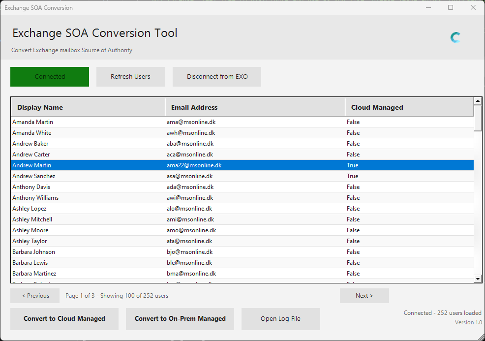

# Exchange SOA Conversion Tool

A PowerShell GUI tool for switching the Exchange mailbox *source of authority* between on-premises and Exchange Online in a hybrid environment by toggling `IsExchangeCloudManaged`.

This is intended to support the approach described in:
https://learn.microsoft.com/en-us/exchange/hybrid-deployment/enable-exchange-attributes-cloud-management

## Features

- **Modern GUI interface**: Clean Windows Forms interface with responsive design and modern styling
- **Responsive loading with cancel**: Sign-in and mailbox loading keep the UI responsive and can be cancelled at any time via a Cancel button
- **Automatic module installation**: Checks for `ExchangeOnlineManagement` and installs it in *CurrentUser* scope if needed (ensures the NuGet provider on Windows PowerShell)
- **Exchange Online connectivity**: Uses modern auth via `Connect-ExchangeOnline`
- **Tenant SOA status**: After connect, reads `Get-OrganizationConfig` and shows whether tenant-wide SOA (`BlockExchangeProvisioningFromOnPremEnabled`) is enabled
- **Hybrid-focused user list**: Uses a server-side filter (`IsDirSynced -eq $true`) to load only directory-synced mailboxes
- **Search box**: Instantly filter the loaded users by display name, UPN, primary address, or any alias address (debounced, case-insensitive)
- **Pagination support**: Displays users in pages of 100 with Previous/Next navigation
- **Column sorting**: Click column headers to sort the entire dataset (across all pages) by Display Name, Email Address, Type, or Cloud Managed status
- **CSV backups before conversion**: A CSV backup of mail-related attributes is written before *every* conversion batch, in both directions (cloud and on-prem)
- **Backup All Users**: One-click export of all directory-synced mailboxes to a single CSV
- **Batch conversion**: Multi-select users and convert in bulk with confirmation dialogs, progress bar, and cancel support
- **Cloud conversion**: Sets `IsExchangeCloudManaged = True`
- **On-prem conversion**: Sets `IsExchangeCloudManaged = False`
- **Logging + quick access**: Writes a timestamped log file and includes an **Open Log File** button
- **Connection management**: Connect, refresh, and disconnect from Exchange Online with status indicators
- **Logo support**: Displays custom logo (logo.png) if present in script directory
- **Responsive layout**: Automatically adjusts to window resizing

## Screenshots



*The Exchange SOA Conversion Tool showing a connected session with directory-synced mailboxes.*

## Requirements

- Windows PowerShell 5.1 or later (also runs on PowerShell 7+ on Windows)
- Exchange Online PowerShell module: `ExchangeOnlineManagement`
- Connectivity to Exchange Online endpoints
- **Microsoft Entra Connect Sync version 2.5.190.0 or later** (or Microsoft Entra Cloud Sync) — required for `IsExchangeCloudManaged` / SOA conversion
- Appropriate Exchange Online permissions to run `Get-Mailbox`, `Set-Mailbox`, and `Get-OrganizationConfig`

### Permissions / roles

The signed-in admin account must be able to:

- Run `Get-Mailbox` across the target scope
- Run `Set-Mailbox -IsExchangeCloudManaged ...` on the target recipients

Commonly used roles for this include (depending on your org model):

- **Exchange Administrator** (recommended)
- Hybrid Identity Administrator
- Global Administrator

## Usage

1. **Run the Script**:
   ```powershell
   .\Exchange-SOA-Conversion-Tool.ps1
   ```

2. **Connect to Exchange Online**:
   - Click "Connect to EXO" button
   - Sign in with your Exchange Online admin credentials
   - The tool loads directory-synced (`IsDirSynced = True`) mailboxes with a live counter; press **Cancel** to stop the load
   - Button changes to "Connected" with green color upon successful connection

3. **Search, Navigate and Sort Users**:
   - Type in the **Search** box to filter by name, UPN, primary address, or alias address (applies after a short delay)
   - Use "Previous" and "Next" buttons to navigate through pages of users
   - Each page shows up to 100 users
   - Click any column header (Display Name, Email Address, Type, or Cloud Managed) to sort the entire dataset; sorting re-applies the active search filter
   - Clicking the same column header again reverses the sort order

4. **Convert Users**:
   - Select one or multiple users from the list (multi-select supported)
   - Click "Convert to Cloud Managed" to enable cloud management
   - Click "Convert to On-Prem Managed" to revert to on-premises management
   - Confirm the conversion when prompted — a CSV backup is written for each user *before* the change is applied (users already in the target state are skipped)
   - View batch conversion summary showing successful, skipped, and failed conversions plus the backup file path

5. **Backup All Users**:
   - Click "Backup All Users" to export all directory-synced mailboxes to a single CSV without changing anything
   - Can be cancelled mid-run; a partial file is kept

6. **Refresh User List**:
   - Click "Refresh Users" to reload the mailbox list after conversions

7. **View Logs**:
   - Click "Open Log File" to view the session log in Notepad

8. **Disconnect**:
   - Click "Disconnect from EXO" when finished
   - Tool automatically disconnects when closing the window (if a long operation is running, it is cancelled first and the window closes when the operation stops)

## Backups

Backups are written to a `Backups` subfolder next to the script. If that folder cannot be created, the tool falls back to `Documents\ExchangeSOABackups`.

**File naming** (one file per batch/operation):

```
SOA-Backup_<Operation>_<yyyyMMdd_HHmmss>.csv
```

`Operation` is `ToCloud`, `ToOnPrem`, or `AllUsers`.

**Format**:

- UTF-8 CSV, delimiter `;` (matches the Danish/European Excel list separator)
- Multi-valued attributes (e.g. `EmailAddresses`) are joined with `|`
- Timestamps are formatted `yyyy-MM-dd HH:mm:ss`

**Column groups**:

- **Metadata**: `BackupTimestamp`, `Operation`, `DisplayName`, `UserPrincipalName`, `Alias`, `PrimarySmtpAddress`, `ExternalDirectoryObjectId`, `Guid`, `ExchangeGuid`, `IsDirSynced`, `IsExchangeCloudManaged`, `RecipientType`, `RecipientTypeDetails`
- **Attributes written back to on-premises** (per the Microsoft Learn table): `WindowsEmailAddress`, `EmailAddresses`, `CustomAttribute1`–`CustomAttribute15`, `ExtensionCustomAttribute1`–`ExtensionCustomAttribute5`
- **Other cloud-editable attributes** (overwritten from on-premises when a mailbox is returned to on-prem management): `HiddenFromAddressListsEnabled`, `ForwardingAddress`, `ForwardingSmtpAddress`, `DeliverToMailboxAndForward`, `GrantSendOnBehalfTo`, `AcceptMessagesOnlyFrom`, `AcceptMessagesOnlyFromDLMembers`, `AcceptMessagesOnlyFromSendersOrMembers`, `RejectMessagesFrom`, `RejectMessagesFromDLMembers`, `RejectMessagesFromSendersOrMembers`, `RequireSenderAuthenticationEnabled`, `ModerationEnabled`, `ModeratedBy`, `SendModerationNotifications`, `BypassModerationFromSendersOrMembers`, `LitigationHoldEnabled`, `LitigationHoldDate`, `LitigationHoldOwner`, `RetentionHoldEnabled`, `StartDateForRetentionHold`, `EndDateForRetentionHold`, `RetentionComment`, `RetentionUrl`, `SingleItemRecoveryEnabled`, `AuditEnabled`, `AuditLogAgeLimit`, `AuditAdmin`, `AuditDelegate`, `AuditOwner`, `ArchiveName`, `ArchiveGuid`, `LegacyExchangeDN`, `MailTipTranslations`, `ResourceCapacity`, `ResourceCustom`, `ImmutableId`

**Not covered by the backup**: `AssistantName` (a `Get-User` property, not `Get-Mailbox`), junk email configuration, mailbox permissions, and certificates.

## Log Files

Log files are created in the same directory as the script with the naming format:

```
ExchangeSOAConversion_YYYYMMDD_HHMM.log
```

Logged operations include:

- Exchange Online Management module installation attempts
- Connection to Exchange Online (and tenant-wide SOA status)
- User conversions in both directions, including the path of the CSV backup taken
- Any errors or warnings

## PowerShell Commands

The tool executes the following commands:

**Load users (server-side filter)**:
```powershell
Get-Mailbox -Filter 'IsDirSynced -eq $true' -ResultSize Unlimited
```

**Convert to Cloud Managed**:
```powershell
Set-Mailbox -Identity <Guid> -IsExchangeCloudManaged $true
```

**Convert to On-Premises Managed**:
```powershell
Set-Mailbox -Identity <Guid> -IsExchangeCloudManaged $false
```

## How this maps to the Microsoft guidance

The Microsoft article describes enabling Exchange attribute management in the cloud for hybrid recipients. This tool focuses specifically on flipping the mailbox management flag (`IsExchangeCloudManaged`) for directory-synced mailboxes so you can move the recipient management "source of authority" between:

- Exchange on-premises (traditional hybrid management)
- Exchange Online (cloud-managed attributes)

### What happens after conversion to cloud-managed?

Once a user is converted to **cloud-managed** (`IsExchangeCloudManaged = True`), Exchange attributes for that mailbox can be managed directly in Exchange Online instead of on-premises Exchange. This means:

- **Exchange attributes** can be modified using Exchange Online PowerShell or the Exchange Admin Center
- Changes no longer need to be made in the on-premises Exchange Management Console/Shell
- The mailbox remains directory-synced from on-premises Active Directory, but Exchange-specific attributes are managed in the cloud
- This provides flexibility in hybrid environments where on-premises Exchange may be decommissioned or scaled down

**Important**: The user object itself is still synced from on-premises AD via Entra Connect Sync / Cloud Sync. Only the Exchange recipient attributes are managed in the cloud.

## Reference

For more information about Exchange cloud attributes management, see:
https://learn.microsoft.com/en-us/exchange/hybrid-deployment/enable-exchange-attributes-cloud-management

## Troubleshooting

- **Module Installation Fails**: Ensure you have internet connectivity and appropriate permissions. You can manually install the module using:
  ```powershell
  Install-Module -Name ExchangeOnlineManagement -Scope CurrentUser
  ```

- **Connection Issues**: Verify your credentials have the necessary Exchange Online permissions

- **Conversion Failures**: Check the log file for detailed error messages

## Notes / limitations

- The tool intentionally filters out cloud-only mailboxes and shows only directory-synced mailboxes (`IsDirSynced = True`).
- Per Microsoft guidance, wait for a directory sync cycle **plus up to 24 hours** after `Set-RemoteMailbox` changes or a mailbox move before converting a mailbox to cloud-managed.
- Set `IsExchangeCloudManaged = $false` *before* offboarding a mailbox back to on-premises.
- Reverting to on-prem management overwrites cloud-made Exchange attribute changes with the on-premises values on the next sync cycle — this is why a CSV backup is taken first.
- Changes may take time to reflect depending on your environment and any directory sync / hybrid processes.
- Users are displayed in pages of 100 for better performance with large mailbox counts.
- The tool automatically disconnects from Exchange Online when the window is closed.
- Optional: Place a `logo.png` file in the same directory as the script to display a custom logo in the header.

## Version History

### Version 1.04
- **Responsive UI**: Loading, backup, and conversion stream results with live progress instead of freezing until completion; all long-running operations support a Cancel button
- **Server-side filtering**: `Get-Mailbox -Filter 'IsDirSynced -eq $true'` for faster loads
- **CSV backups**: Mail-related attributes are exported to `Backups\SOA-Backup_<Operation>_<timestamp>.csv` before every conversion in *both* directions
- **Backup All Users**: New button to export all directory-synced mailboxes to a single CSV
- **Search box**: Filter loaded users by name or any mail address
- **New "Type" column**: Shows `RecipientTypeDetails`, sortable
- Conversion now uses the mailbox **GUID** as identity and skips users already in the target state
- After connect, the tenant-wide SOA status (`BlockExchangeProvisioningFromOnPremEnabled`) is shown in the status bar
- Disconnect/close now guard against running when not connected; NuGet provider ensured before module install

### Version 1.03
- **Comprehensive attribute logging**: When converting to cloud-managed, the following attributes are now logged:
  - Primary SMTP address and all email aliases
  - CustomAttribute1 through CustomAttribute15
  - HiddenFromAddressListsEnabled status
- **License protection**: Provides complete audit trail in case mailbox licenses are removed and attributes get lost

### Version 1.02
- **Column sorting improvements**: Sorting now updates immediately after user conversions without requiring a refresh
- **Bug fix**: Fixed sorting to work across all pages, not just the current page
- **Data consistency**: User conversions now update both the display and underlying dataset for accurate sorting

### Version 1.0
- Initial release
- GUI interface for Exchange SOA conversion
- Pagination support for large user lists
- Batch conversion capabilities
- Automatic module installation
- Logging and connection management
